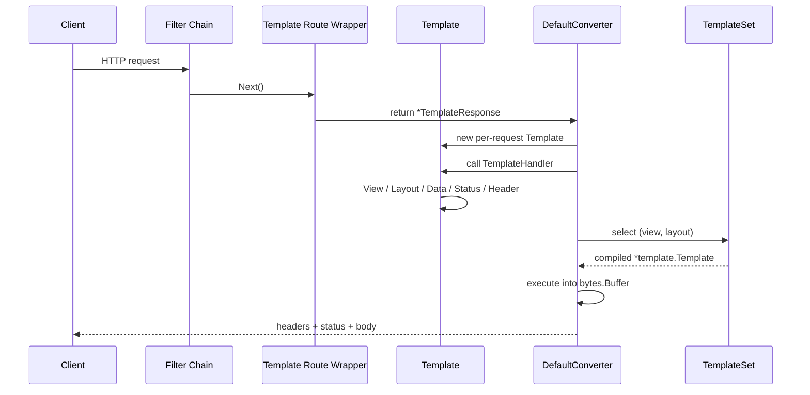

# HTML 模板渲染设计草案

> 状态：框架核心已实现；`http2smtp/webui` 迁移和 Builder 便捷入口暂未实施。
>
> 目标场景：为 Go Web Frame 增加服务端 HTML 模板路由，并优先支持
> `http2smtp/webui` 现有的 `embed.FS`、布局、公共片段和多语言页面。

## 1. 背景

当前框架的 Handler 统一返回 `(any, error)`，再由 `Converter` 写入 HTTP
响应。默认 Converter 已经识别字符串、JSON、文件、SSE、WebSocket 等类型，但还没有
原生的 HTML 模板返回类型。

当前拟议入口为：

```go
func (server *Server) Template(
    httpMethod string,
    relativePath string,
    handler TemplateHandler,
) *Route
```

`http2smtp/webui` 已经把模板和静态资源嵌入二进制：

```go
import "embed"

//go:embed templates
var templatesFS embed.FS

//go:embed static
var staticFS embed.FS
```

它的页面组织方式如下：

```text
webui/templates/
├── layout.html       # 完整后台布局，定义 "layout"，内部调用 "content"
├── bare.html         # 登录/初始化等简洁布局，也定义 "layout"
├── partials.html     # 公共片段，如 field、pager
├── dashboard.html    # 页面文件，定义 "content"
└── login.html        # 页面文件，定义 "content"
```

因此，新设计不能只接受一个固定模板文件，也不能把所有页面放进同一个
`html/template.Template`。原因是多个页面都会定义名为 `content` 的 block，合并解析时
会互相覆盖。

## 2. 目标与非目标

### 2.1 目标

- 使用标准库 `html/template`，默认进行 HTML 上下文转义。
- 直接接受 `embed.FS`，同时允许开发模式使用 `os.DirFS`。
- 每个页面和布局编译为独立模板集合，支持同名 `content` block。
- 复用现有 Filter、Route 元数据和 Converter 链路。
- 支持类型化页面数据，不要求统一转换成 `map[string]any`。
- 支持页面状态码、响应头、重定向和 HTML 错误页。
- 渲染先写缓冲区，失败时不输出半页 HTML。
- release 模式只解析一次；开发模式可按请求重新读取模板。
- 静态资源继续使用现有 `http.FileSystem` 能力，不混入模板引擎。

### 2.2 非目标

- 不托管用户上传的 Go 模板，也不把模板当作安全沙箱。
- 不引入第三方模板引擎。
- 不自动扫描路由并推断页面文件。
- 第一版不支持模板热替换后的跨请求 last-known-good 双版本切换。
- 第一版不试图替代前端 SPA、静态站点或通用页面构建器。
- 第一版不提供 ORM、Session 或 i18n 的实现，这些仍由应用层负责。

## 3. 核心设计决策

| 项目 | 决策 |
| --- | --- |
| 模板引擎 | `html/template` |
| 模板来源 | 任意 `fs.FS`，包括 `embed.FS` 和 `os.DirFS` |
| 页面组织 | 每个 `(view, layout)` 组合独立编译 |
| 公共片段 | 在编译每个页面时一起加入 |
| 模板函数 | 解析前通过 Option 注册 |
| 数据 | `any`，推荐使用页面自己的结构体 |
| 渲染时机 | Converter 收到 `TemplateResponse` 后调用 `TemplateHandler` 并渲染 |
| 输出方式 | 先渲染到 `bytes.Buffer`，成功后一次写入响应 |
| 缓存 | release 模式永久复用编译结果 |
| 开发模式 | `WithDevReload(true)` 设置默认值，`Template.Reload` 可按请求覆盖 |
| 静态资源 | 使用 `fs.Sub + http.FS` 或 `http.Dir`，沿用现有静态路由 |
| 错误 | 预留数据准备失败、模板不存在、执行失败三个阶段 |

## 4. 公共 API 草案

### 4.1 模板对象和处理函数

```go
package web

// Template 表示一次请求中的页面渲染状态。
// 它只在当前请求内有效，不保存到全局缓存。
type Template struct {
    // 字段均为内部字段
}

// TemplateHandler 为页面准备数据、布局和响应元信息。
// 它不是中间件，不支持 Next。
type TemplateHandler func(view *Template) error

// TemplateResponse 保存页面 Handler，交给 Converter 执行。
type TemplateResponse struct {
    Handler TemplateHandler
}

func (t *Template) Request() *Request

// View 选择逻辑页面名，不含扩展名，例如 "dashboard"。
func (t *Template) View(name string) *Template

// Layout 选择布局名，不含扩展名，例如 "layout" 或 "bare"。
func (t *Template) Layout(name string) *Template

// Data 设置传给模板的页面数据。重复调用时后一次覆盖前一次。
func (t *Template) Data(data any) *Template

// Status 设置最终 HTML 响应的 HTTP 状态码，默认是 200。
func (t *Template) Status(code int) *Template

// Header 设置最终响应头。Content-Type 由框架统一控制。
func (t *Template) Header(key, value string) *Template

// Redirect 让当前响应改为重定向，不再渲染页面。
func (t *Template) Redirect(code int, location string) *Template

// Reload 覆盖 TemplateSet 的默认重载设置。
// true 时重新解析当前页面、布局和公共片段，false 时复用预编译结果。
func (t *Template) Reload(reload bool) *Template
```

### 4.2 模板集合

模板集合和单次请求的页面状态分离。编译结果可以跨 Server 重建复用：

```go
package web

type TemplateSet struct {
    // 编译缓存及来源信息
}

type TemplateOption func(*templateOptions)

func WithTemplateFuncs(funcs template.FuncMap) TemplateOption

// WithLayouts 注册可选的布局名，第一个作为默认布局。
func WithLayouts(defaultLayout string, others ...string) TemplateOption

// WithPartials 注册所有页面都会加载的公共片段。
func WithPartials(names ...string) TemplateOption

// WithDevReload 设置所有模板响应的默认重载行为。
// 页面 Handler 可通过 Template.Reload 单独覆盖。
func WithDevReload(enabled bool) TemplateOption

func LoadTemplates(
    fsys fs.FS,
    root string,
    options ...TemplateOption,
) (*TemplateSet, error)

func (server *Server) SetTemplates(set *TemplateSet)
```

根目录为 `templates` 时，逻辑名称和文件的对应关系如下：

| 逻辑名称 | 文件 |
| --- | --- |
| 页面 `dashboard` | `templates/dashboard.html` |
| 布局 `layout` | `templates/layout.html` |
| 布局 `bare` | `templates/bare.html` |
| 公共片段 `partials` | `templates/partials.html` |

第一版默认使用 `.html` 扩展名。后续如需支持 `.gohtml`、`.tmpl`，可以增加
`WithTemplateExtension`，不影响当前接口。

### 4.3 路由入口

```go
func (server *Server) Template(
    httpMethod string,
    relativePath string,
    handler TemplateHandler,
) *Route
```

同时建议给 `core.Context` 增加同构入口，便于在 `Rest.Init` 中直接使用：

```go
func (c *Context) Template(
    httpMethod string,
    relativePath string,
    handler web.TemplateHandler,
) *web.Route
```

它只负责委托给 `c.Server().Template(...)`，不复制路由逻辑。

常用 HTTP 方法另提供便捷入口，`Server` 和 `Context` 的签名一致：

```go
server.GetTemplate("/dashboard", dashboardPage)
server.PostTemplate("/login", loginPage)
server.PutTemplate("/settings", settingsPage)
server.DeleteTemplate("/account", accountPage)
server.PatchTemplate("/profile", profilePage)

ctx.GetTemplate("/dashboard", dashboardPage)
ctx.PostTemplate("/login", loginPage)
```

这些方法只固定 HTTP 方法，最终仍然调用 `Template(...)`。

## 5. 模板编译模型

### 5.1 为什么不能一次解析全部页面

`http2smtp` 的每个页面都这样定义：

```html
{{define "content"}}
<h1>Dashboard</h1>
{{end}}
```

布局则定义另一个 block：

```html
{{define "layout"}}
<html>
<body>
  {{template "content" .}}
</body>
</html>
{{end}}
```

如果一次解析所有页面，`content` 会被最后一个文件覆盖。正确方式是每个页面单独
编译，例如：

```go
template.New("dashboard").
    Funcs(funcs).
    ParseFS(templatesFS,
        "templates/layout.html",
        "templates/partials.html",
        "templates/dashboard.html",
    )
```

这样，每个模板集合中只包含一个页面各自的 `content` block。

### 5.2 编译矩阵

`LoadTemplates` 扫描根目录，排除布局和公共片段后得到页面列表，并为页面与布局的
组合建立缓存：

```text
(dashboard, layout) -> *template.Template
(dashboard, bare)   -> *template.Template
(login, layout)     -> *template.Template
(login, bare)       -> *template.Template
```

实际缓存键建议使用内部结构：

```go
type templateKey struct {
    view   string
    layout string
}
```

编译时始终加入：

1. 所选布局文件，例如 `layout.html`；
2. 配置的全部公共片段，例如 `partials.html`；
3. 所选页面文件，例如 `dashboard.html`。

最终统一执行根模板名 `layout`：

```go
tmpl.ExecuteTemplate(&buf, "layout", data)
```

页面文件不需要知道完整路径，也不需要改成框架私有语法。

### 5.3 校验规则

- `root` 必须是不含 `..` 的相对路径；空值按 `.` 处理。
- 页面、布局和公共片段名必须拒绝空值、绝对路径、反斜杠和 `..`。
- 页面或布局不存在时，`LoadTemplates` 返回包含逻辑名称的错误。
- 页面必须定义 `content`，布局必须定义 `layout`；实际执行时缺失直接视为模板错误。
- 重复出现同名定义时，不依赖 Go 模板的覆盖顺序，配置阶段应尽量提前报错。
- 模板函数必须在任何页面解析前注册，因为 `html/template` 在解析阶段绑定函数。

## 6. 请求执行流程



具体步骤：

1. 路由仍通过 `server.Handle` 注册，因此现有 Filter、路由元数据和重复路由检查全部生效。
2. Filter 调用 `Next()` 后才进入 Template 路由包装函数。
3. 包装函数返回包含单个 `TemplateHandler` 的 `*TemplateResponse`。
4. `DefaultConverter` 识别 `*TemplateResponse`，创建只属于当前请求的 `*Template`。
5. Converter 调用 `TemplateHandler`；Handler 返回错误时不渲染页面，错误交给现有错误转换流程。
6. Handler 完成后，Converter 选择编译后的模板并执行。
7. 渲染完整成功后才写入状态码、响应头和 HTML 字节。

路由入口按以下固定写法实现：

```go
func (server *Server) Template(
    httpMethod string,
    relativePath string,
    handler TemplateHandler,
) *Route {
    return server.Handle(httpMethod, relativePath, func(r *Request) (any, error) {
        return &TemplateResponse{
            Handler: handler,
        }, nil
    })
}
```

`TemplateResponse` 必须由 Converter 识别；否则它会被当作普通值序列化成 JSON。

## 7. TemplateHandler 语义

### 7.1 单文件页面构建

每条模板路由接收一个 Handler：

```go
server.Template(http.MethodGet, "/dashboard", dashboardPage)
```

Handler 只负责选择页面、布局并准备数据。页面实际渲染由
`DefaultConverter.TemplateResponse` 完成。

### 7.2 不是中间件

`TemplateHandler` 没有 `Next()`，不能“拦截后决定是否继续”。认证、限流、CSRF、
请求日志等横切逻辑继续使用 Filter；页面数据准备和页面选择才使用 TemplateHandler。

### 7.3 错误处理

- 数据查询失败：返回原始业务错误，沿用 `web.ErrorCode` 映射。
- 模板不存在：属于服务端配置错误，建议统一返回 500，不向客户端暴露文件路径。
- 模板执行失败：记录内部错误，返回通用 HTML/JSON 错误响应。
- 页面业务状态，例如登录失败，不应该返回 error，而应设置：

```go
t.View("login").
    Layout("bare").
    Status(http.StatusUnauthorized).
    Data(loginData)
```

### 7.4 重定向

页面 Handler 可以设置：

```go
t.Redirect(http.StatusFound, "/dashboard")
```

Converter 检测到重定向状态后，只写 `Location` 和状态码，不执行模板。

### 7.5 按请求重载

重载由框架执行。`WithDevReload` 提供默认值，页面 Handler 可以按当前请求覆盖：

```go
view.View("dashboard").
    Layout("layout").
    Reload(developmentMode).
    Data(data)
```

`Reload(true)` 会重新读取并解析当前页面、布局和公共片段；`Reload(false)` 使用
`TemplateSet` 中已经编译的版本。该开关只控制模板解析，不会重新扫描新增页面文件。

## 8. `http2smtp/webui` 接入示例

### 8.1 保留现有 embed 声明

```go
package webui

import "embed"

//go:embed templates
var templatesFS embed.FS

//go:embed static
var staticFS embed.FS
```

应用层如果仍需要开发模式切换，可以继续保留当前的 `devMode`。

### 8.2 加载模板集合

```go
var (
    templateSetOnce sync.Once
    templateSet     *web.TemplateSet
    templateSetErr  error
)

func loadTemplateSet() (*web.TemplateSet, error) {
    templateSetOnce.Do(func() {
        var fsys fs.FS = templatesFS
        root := "templates"

        if devMode {
            fsys = os.DirFS("webui/templates")
            root = "."
        }

        options := []web.TemplateOption{
            web.WithTemplateFuncs(templateFuncs),
            web.WithLayouts("layout", "bare"),
            web.WithPartials("partials"),
        }
        if devMode {
            options = append(options, web.WithDevReload(true))
        }

        templateSet, templateSetErr = web.LoadTemplates(fsys, root, options...)
    })
    return templateSet, templateSetErr
}
```

模板函数仍使用 `webui/templateFuncs`：

```go
var templateFuncs = template.FuncMap{
    "dict":      dict,
    "seq":       seq,
    "flashText": flashText,
    // 其他已有函数
}
```

不要把 `Request`、当前语言或用户信息闭包进全局 `FuncMap`。这些值在请求期变化，
应继续通过 `.L`、`.User`、`.Path` 等页面数据传递。

### 8.3 在 `Pages.Init` 中注册

```go
func (p *Pages) Init(ctx *core.Context) error {
    templates, err := loadTemplateSet()
    if err != nil {
        return err
    }
    server := ctx.Server()
    server.SetTemplates(templates)

    // 页面路由继续使用与当前相同的根路径。
    ctx.Template(http.MethodGet, "/dashboard", p.dashboardPage)
    ctx.Template(http.MethodGet, "/smtp", p.smtpListPage)

    return nil
}
```

### 8.4 将现有 render 适配为 TemplateHandler

现有代码里的模式是：

```go
func (p *Pages) dashboard(req *web.Request) (any, error) {
    data := ...
    return p.render(req, "dashboard", data)
}
```

迁移后可以保留数据构建函数，只把最后的渲染改成页面描述：

```go
func templatePage(name string, build func(*web.Request) (any, error)) web.TemplateHandler {
    return func(t *web.Template) error {
        data, err := build(t.Request())
        if err != nil {
            return err
        }
        t.View(name).
            Layout("layout").
            Data(data)
        return nil
    }
}
```

注册示例：

```go
ctx.Template(
    http.MethodGet,
    "/dashboard",
    templatePage("dashboard", p.dashboardData),
)
```

登录页和错误页使用 `bare`：

```go
t.View("login").
    Layout("bare").
    Data(data)
```

这样现有的 `layout.html`、`bare.html`、`partials.html` 和所有页面文件都不需要改成
新的模板语法。

## 9. `staticFS` 接入

静态资源不应经过 `html/template`。继续使用现有 `http.FileSystem` 路由：

```go
staticRoot, err := fs.Sub(staticFS, "static")
if err != nil {
    return err
}

ctx.StaticFs("/static", http.FS(staticRoot))
```

路径映射：

| 请求路径 | embed 文件 |
| --- | --- |
| `/static/app.css` | `static/app.css` |
| `/static/ui.js` | `static/ui.js` |
| `/static/icons.svg` | `static/icons.svg` |

开发模式继续使用工作区目录：

```go
ctx.StaticFs("/static", http.Dir("webui/static"))
```

如果需要同时提供根路径下的 `/favicon.svg` 和 `/icons.svg`，继续保留现有的独立文件
路由即可。第一版不把 `staticFS` 混入模板 API。

## 10. 响应与安全

### 10.1 原子写出

模板执行必须遵守以下顺序：

1. 查找并执行模板到缓冲区；
2. 执行成功；
3. 写入状态码；
4. 写入业务响应头；
5. 设置 `Content-Type: text/html; charset=utf-8`；
6. 一次写出版本完整的 HTML。

不能在模板执行前直接向 `Response` 写内容，否则执行失败时会形成半页 HTML，也无法
安全修改状态码。

### 10.2 自动转义

必须使用 `html/template`，不能使用 `util.ParseTemplate` 当前依赖的
`text/template` 来处理 Web 页面。

默认情况下，下面的数据会被自动转义：

```html
<td>{{.UserName}}</td>
```

只有应用明确拥有可信 HTML 时才允许使用 `template.HTML`。禁止把用户输入直接转换为
`template.HTML`、`template.JS` 或 `template.URL`。

### 10.3 模板来源

模板属于服务端代码的一部分：

- 生产环境从 `embed.FS` 加载；
- 开发环境从受控工作目录加载；
- 不允许从表单、数据库或 HTTP 请求得到模板名称后直接拼接文件路径；
- `View` 和 `Layout` 只接受已注册的逻辑名称，不接受任意路径。

### 10.4 错误信息

模板文件不存在、layout 缺失或执行失败属于服务端错误。日志中保留完整错误和模板名；
客户端只看到通用 500 页面或 JSON 错误，避免泄露目录结构。

## 11. 并发与性能

- 一个 `TemplateSet` 编译后是只读的，可以被多个请求并发使用。
- `html/template` 已解析完成后的执行可以并发进行。
- 每次请求单独创建 `*Template`，不能把页面数据或状态放到 Server 全局变量中。
- release 模式不访问磁盘，也不需要每个请求重新解析模板。
- 当前 webui 有约 20 个页面和 2 个布局，预编译几十个模板集合的内存成本可接受。
- `TemplateSet` 与实际 `Server` 分离，可以在应用重启、重建 Server 时复用。
- `Template.Reload(true)` 只用于开发模式，不应用于 release 构建。

## 12. 与现有 Converter 的关系

`DefaultConverter` 需要增加一个分支：

```go
case *TemplateResponse:
    c.TemplateResponse(request, t)
```

同时提供可复用的导出方法：

```go
func (c *DefaultConverter) TemplateResponse(request *Request, value *TemplateResponse)
```

自定义 Converter 如果嵌入 `DefaultConverter`，但仍自行处理所有返回值，需要显式
委托：

```go
case *web.TemplateResponse:
    c.DefaultConverter.TemplateResponse(req, v)
```

不要把 `*TemplateResponse` 当作普通数据交给 JSON 分支。否则页面会变成序列化结果。

## 13. 兼容性与迁移范围

### 13.1 框架层

不修改现有 `HandlerFunc`、`Filter`、`Converter` 的方法签名。新增能力是：

- `Template`；
- `TemplateHandler`；
- `TemplateSet`；
- `TemplateOption`；
- `DefaultConverter` 的模板分支；
- `core.Context.Template` 便捷入口。

### 13.2 `http2smtp/webui`

建议分三步迁移：

1. 保留 `embed.go`、`layout.html`、`bare.html`、`partials.html` 和全部页面模板。
2. 用 `LoadTemplates` 替代 `parseTemplates` / `templateFor` 的缓存部分。
3. 先迁移只读 GET 页面，再迁移表单错误页和重定向页面。

现有 `p.render` 在迁移完成后可以删除，或暂时保留给尚未迁移的页面使用。两种渲染
方式可以在同一个应用中并存。

### 13.3 Builder 层

第一版可以只实现 `Server.Template` 和 `Context.Template`。如果之后希望支持
`builder.Template(...)`，需要额外把 `TemplateSet` 从 Builder 传递到最终 Server，
这不应混入第一版的核心改动。

## 14. 测试计划

### 14.1 框架测试

- 注册 Template 路由后，普通 Filter 只执行一次。
- 单个 Handler 能完整设置页面、布局、数据和响应元信息。
- Handler 返回 error 时停止执行并且不渲染。
- `layout + partials + page` 能正确组合。
- `bare + partials + page` 能正确组合。
- 不同页面的 `content` block 不互相污染。
- 数据可以从结构体读取。
- 状态码、响应头和重定向正确。
- 缺失页面、缺失布局、模板执行失败时返回 500，且没有部分响应体。
- 用户输入中的 `<script>` 被自动转义。
- 并行请求使用同一 `TemplateSet` 时不发生数据竞争。
- `embed.FS` 和 `fstest.MapFS` 都可以使用。
- 开发重载模式能读取到修改后的模板。

### 14.2 `http2smtp/webui` 验证

- `dashboard`、`login`、`setup` 分别使用预期布局。
- 登录失败返回 401 的 HTML 页面。
- 未登录访问受保护页面时，现有认证 Filter 行为保持不变。
- 多语言页面仍通过 `.L.T` 输出。
- 所有现有 `templatesFS` 页面可以被扫描并通过语法解析。
- `/static/app.css`、`/static/ui.js`、`/favicon.svg` 从对应 embed 文件返回。
- release 构建不依赖工作区中的 `webui/templates` 和 `webui/static`。

## 15. 验收标准

满足以下条件后可以进入开发：

1. 使用给定的 `templatesFS embed.FS` 可以直接加载模板，不需要复制或解包文件。
2. 使用给定的 `staticFS embed.FS` 可以通过 `fs.Sub + http.FS` 正常提供静态资源。
3. 现有 `layout.html`、`bare.html`、`partials.html` 无需修改即可渲染。
4. 多个页面可以同时定义 `content`，且不会互相覆盖。
5. 页面渲染失败时不会写出半页 HTML。
6. release 模式每个模板组合只编译一次。
7. 开发模式可通过 `WithDevReload(true)` 设置默认重载，并由
   `Template.Reload(bool)` 按请求覆盖。
8. 默认 Converter、Filter、路由元数据和错误码行为保持向后兼容。

## 16. 后续可扩展项

- 配置式 MIME 和缓存头，例如 static asset 的 `ETag`、`Cache-Control`。
- 模板文件名和逻辑名映射表。
- 多扩展名支持。
- 模板依赖追踪和精确热重载。
- last-known-good 模式：开发模式模板解析失败时继续使用上一版。
- 模板指标和慢渲染日志。
- `TemplateGet` 等便捷注册方法。
